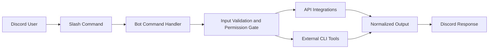

# Discord OSINT Assistant

[](https://github.com/gl0bal01/discord-osint-assistant/actions/workflows/ci.yml)
[](LICENSE)
[](https://doi.org/10.5281/zenodo.15741849)

Discord OSINT Assistant is a self-hosted Discord intelligence bot for Open Source Intelligence (OSINT) investigations. It exposes 32 investigation workflows as Discord slash commands for reconnaissance, attribution, enrichment, and analysis.

## In Two Minutes

Needs Node.js 22.12+ and [Bun](https://bun.sh/).

```bash
git clone https://github.com/gl0bal01/discord-osint-assistant.git
cd discord-osint-assistant
bun install
cp .env.example .env              # set DISCORD_TOKEN, CLIENT_ID and GUILD_ID
bun run deploy                    # register the slash commands in GUILD_ID
bun run start
```

The full setup guide (Discord application, API keys, CLI tools, Docker, systemd) is [docs/INSTALLATION.md](docs/INSTALLATION.md).

## Why This Project

- Standardize OSINT workflows for teams working inside Discord
- Reduce setup overhead for investigators and analysts
- Keep operational controls close to command execution (validation, permissions, rate limits)
- Integrate API-based and CLI-based data sources behind one command surface

## Features

- 32 slash commands across identity, network, media, blockchain, transport, business, analysis, and operations workflows
- `/bob-chat` supports multi-model chat, code generation, OSINT analysis, and speech-to-text transcription
- Optional integrations with third-party APIs and local external tools
- Two Docker images: lean by default, or `full` with every CLI tool preinstalled
- Security-focused runtime controls for process execution and URL handling
- Container-ready deployment and CI validation

## Architecture



## Command Catalog

The bot currently provides 32 commands across 8 functional areas. Run `/bob-help` in Discord to list every command live with its description.

[docs/COMMANDS.md](docs/COMMANDS.md) is the full reference, generated from the command definitions: every subcommand and option with its choices and limits, the required permission, the rate-limit tier, and whether the command needs the `full` Docker image.

### Identity and Social

`/bob-sherlock`, `/bob-maigret`, `/bob-linkook`, `/bob-ghunt`, `/bob-generate-usernames`, `/bob-nuclei`

### Domain and Network

`/bob-dns`, `/bob-whoxy`, `/bob-hostio`, `/bob-web-recon`, `/bob-redirect-check`, `/bob-favicon`

### Image and Media

`/bob-exif`, `/bob-rekognition`

### Blockchain

`/bob-blockchain`, `/bob-blockchain-detect`

#### `/bob-blockchain` Subcommands

- `address` / `transaction` / `block`: look up an address, transaction, or block across 9 chains (BTC, ETH, LTC, BCH, DOGE, DASH, ZEC, BSC, Polygon). These three subcommands take a `network:mainnet|testnet` option; testnet is supported for ETH (Sepolia), BSC, Polygon (Amoy), and BTC/LTC/BCH/DASH/DOGE (via Blockchair).
- `trace`: follow-the-money graph tracer for EVM chains via the Etherscan V2 multichain API. Recursively crawls transactions from a start address and returns the dominant native-value path, top sinks (where value accumulates), and known-entity / high-degree hubs to ignore, plus CSV / JSON / Mermaid exports. Key addresses are enriched with balance, tx count, and last activity, and known exchanges/mixers/bridges are labeled. Options: `address`, `chain`, `depth` (1-3), `max-tx`, `direction` (both/out/in), `types`, and `focus` (spotlight one address's direct in/out flows). `trace` has no `network` option: `chain` takes the chain ID, one of `1` (Ethereum), `11155111` (Sepolia), `56` (BNB Chain), `137` (Polygon), `42161` (Arbitrum One), `10` (Optimism), `8453` (Base), `43114` (Avalanche C-Chain), `250` (Fantom). Requires `ETHERSCAN_API_KEY`.

`/bob-blockchain-detect` also recognizes testnet address formats (BTC/LTC/BCH/DOGE/DASH) and notes that EVM addresses are format-ambiguous between mainnet and testnet.

### Transportation

`/bob-flight`, `/bob-airport`, `/bob-flight-number`, `/bob-vessel`

### Business Intelligence

`/bob-pappers`, `/bob-vpic`, `/bob-nike`

### Analysis

`/bob-chat`, `/bob-jwt`, `/bob-xeuledoc`, `/bob-extract-links`, `/bob-dork`

### Operations

`/bob-health`, `/bob-help`, `/bob-monitor`, `/bob-upload`

Commands that wrap a CLI tool (`/bob-sherlock`, `/bob-maigret`, `/bob-linkook`, `/bob-ghunt`, `/bob-nuclei`, `/bob-exif`, `/bob-jwt`, `/bob-xeuledoc`) are only registered and loaded when their tool is installed, so the lean image shows just the commands that work.

### `/bob-chat` Subcommands

#### `ask`

General AI assistance with optional context presets.

| Parameter | Required | Description |
|-----------|----------|-------------|
| `message` | **Yes** | Your question or request (max 2000 chars) |
| `model`   | No       | Claude Haiku 5.5 (default), Claude Sonnet 5.5, Claude Opus 5.5, Claude Fable 5.1, GPT-6 Luna, GPT-6.1 Sol, GPT-6 Astra, Gemini 3.8 Flash, Gemini 4 Argon, Grok 4.7, DeepSeek V4.1 Flash, DeepSeek V4 Pro, Qwen3.8 Max, Kimi K3, GLM-5.3, Mistral Medium 3.5, Muse Wonder, Sonar, Sonar Pro, Sonar Reasoning Pro, Sonar Deep Research |
| `context` | No       | `general` (default), `osint`, `data`, `investigation`, `technical`, `report` |

Sonar models answer with live web search (5 sites, 10 for Deep Research).

**Example**
```
/bob-chat ask message:"Analyze this breach data for patterns" model:sonar-reasoning-pro context:osint
```

---

#### `code`

Generate code for OSINT automation and data analysis.

| Parameter    | Required | Description |
|--------------|----------|-------------|
| `request`    | **Yes**  | Describe the code you need (max 2000 chars) |
| `language`   | No       | `python` (default), `javascript`, `bash`, `powershell`, `sql`, `other` |
| `model`      | No       | Claude Sonnet 5.5 (default), Claude Opus 5.5, Gemini 4 Argon, Grok 4.7, Kimi K2.7 Code, DeepSeek V4 Pro, GLM-5.3 |
| `new-context`| No       | Start a fresh code conversation (`false` by default) |

Code is returned as Discord code blocks; the model's reasoning is stripped.

**Example**
```
/bob-chat code request:"Script that fetches subdomains from crt.sh" language:python
```

---

#### `analyze`

Structured OSINT analysis of findings or raw data (Claude Sonnet 5.5).

| Parameter       | Required | Description |
|-----------------|----------|-------------|
| `data`          | **Yes**  | The data or findings to analyze (max 2000 chars) |
| `analysis-type` | No       | `summary` (default), `pattern`, `threat`, `link`, `timeline`, `risk` |

**Example**
```
/bob-chat analyze data:"IP 198.51.100.5 contacted our honeypot 42 times using user-agent 'Mozilla/5.0 CustomBot'" analysis-type:threat
```

**Analysis types**
- `pattern` – Pattern recognition and anomaly detection
- `threat` – Threat assessment and security implications
- `link` – Relationship and connection mapping
- `timeline` – Timeline reconstruction from events
- `risk` – Risk assessment
- `summary` – High-level summary and key insights

---

#### `transcribe`

Speech-to-text via 1min.ai audio models.

| Parameter    | Required | Description |
|--------------|----------|-------------|
| `audio-url`  | **Yes**  | Asset path returned by the 1min.ai Asset API (e.g. `fileContent.path`) |
| `stt-model`  | No       | `qwen3-asr-flash` (default) or `phone_call` |
| `language`   | *Cond.*  | **Required** for `phone_call` (BCP-47 style, e.g. `en-US`, `vi-VN`, `zh-CN`). Optional for `qwen3-asr-flash` (e.g. `en`, `zh`, `ja`; auto-detect if omitted) |
| `enable-itn` | No       | Qwen3 only: enable inverse text normalization (`false` by default) |

**Transcription workflow**
1. Upload your audio file to the 1min.ai Asset API (`POST /api/assets`).
2. Copy the returned asset path (usually inside `fileContent.path`).
3. Run the slash command with that path.

**Example – Qwen3 ASR Flash (auto-detect language)**
```
/bob-chat transcribe audio-url:"https://cdn.1min.ai/.../recording.wav"
```

**Example – Qwen3 ASR Flash (explicit language + ITN)**
```
/bob-chat transcribe audio-url:"https://cdn.1min.ai/.../recording.wav" language:en enable-itn:true
```

**Example – Phone Call model**
```
/bob-chat transcribe audio-url:"https://cdn.1min.ai/.../call.wav" stt-model:phone_call language:en-US
```

---

#### `reset`

Clear conversation context so the next interaction starts fresh.

| Parameter | Required | Description |
|-----------|----------|-------------|
| `model`   | No       | `all` (default), `chat`, `code`, `analysis` |

**Example**
```
/bob-chat reset model:code
```

---

### `/bob-upload`

Upload a Discord attachment to the 1min.ai Asset API so it can be referenced by AI features (e.g. `/bob-chat transcribe`).

| Parameter | Required | Description |
|-----------|----------|-------------|
| `file`    | **Yes**  | The file to upload (max 50 MB) |

**Supported file types**
- Images: PNG, JPEG, WEBP, GIF, SVG
- Documents: PDF, DOC, DOCX, TXT
- Data: JSON, CSV, XML
- Audio: WAV, MP3, OGG, M4A (for transcription)

**Example**
```
/bob-upload file:<attach your audio file>
```

**Response fields**
- **Asset Path** (`fileContent.path`) — the value you pass to `audio-url` in `/bob-chat transcribe`
- **UUID** — unique identifier for the uploaded asset
- **Direct URL** — full S3 location (requires authentication)

**Workflow for transcription**
1. Run `/bob-upload` and attach your audio file.
2. Copy the **Asset Path** from the response.
3. Run `/bob-chat transcribe audio-url:<asset-path>`.

---

### `/bob-ghunt` Authentication

GHunt requires a valid Google session before it can perform lookups. The bot can detect login status and accept fresh credentials directly from Discord.

| Operation | Parameter | Description |
|-----------|-----------|-------------|
| `type:check-login` | — | Verify whether GHunt credentials exist and are valid |
| `type:login` | `query` or `token` | Save a new base64 token from GHunt Companion (Administrator only) |
| `type:email` | `query` | Lookup an email address |
| `type:gaia` | `query` | Lookup a Gaia ID |
| `type:drive` | `query` | Analyze a Google Drive file/folder URL |
| `type:geolocate` | `query` | Geolocate a BSSID (`XX:XX:XX:XX:XX:XX`) |
| `type:spiderdal` | `query` | Find assets using Digital Asset Links |

Two boolean options tune the lookups: `sight:true` also searches Google Sight profiles (`type:email` only), and `driver:true` uses a Chrome driver instead of plain requests (`type:email` and `type:gaia`).

**How to authenticate**
1. Install the [GHunt Companion](https://github.com/mxrch/GHunt/tree/master/gc-assets) browser extension (Firefox or Chrome).
2. Log in to your Google account in the browser.
3. Click the extension icon and copy the base64 string.
4. Run the login command:
   ```
   /bob-ghunt type:login query:<paste-base64-here>
   ```

**Check your session**
```
/bob-ghunt type:check-login
```

**Run a lookup**
```
/bob-ghunt type:email query:target@gmail.com
```

**Environment variable**
- `GHUNT_CREDS_PATH` — custom path for the credentials file (default: `~/.malfrats/ghunt/creds.m`).

## Configuration

Copy `.env.example` to `.env`. Only `DISCORD_TOKEN` and `CLIENT_ID` are required; `GUILD_ID` is read only by `bun run deploy` (guild commands).

- [`.env.example`](.env.example) is the complete, commented reference of every environment variable and its default.
- [docs/INSTALLATION.md](docs/INSTALLATION.md#api-keys) lists where to get each API key and which command uses it.

If an API key is missing, the related command returns a descriptive error. If a CLI tool is missing, its command is not registered at all.

## Operations

### Logging

The bot uses [pino](https://getpino.io/) for structured JSON logging.

| Variable    | Default | Accepted values                          |
|-------------|---------|------------------------------------------|
| `LOG_LEVEL` | `info`  | `trace`, `debug`, `info`, `warn`, `error`, `fatal`, `silent` |

In development (non-production and interactive TTY) logs are pretty-printed via `pino-pretty`. In production, raw JSON is written to stdout for ingestion by log aggregators. Secrets are redacted before output: see [SECURITY.md](SECURITY.md#structured-logging-and-secret-redaction).

### Health Check

The bot writes its Discord gateway state to `HEALTH_FILE` (default `./temp/.health/health.json`) every 5 seconds. `scripts/healthcheck.js` turns it into an exit code: the Docker `HEALTHCHECK` runs it (`make dhealth` shows the result), and on a systemd host you run `bun run scripts/healthcheck.js`. Its time windows are fixed; see [SECURITY.md](SECURITY.md#healthcheck).

### Reports Archive

Besides the Discord attachment, command exports (Sherlock, Maigret, Nuclei, Linkook, GHunt, blockchain, and others) are copied to `reports/`. They hold personal data about investigation subjects, so they are owner-only (`0700` directory, `0600` files) and **ephemeral by default**:

- Docker: `/app/reports` is a tmpfs, wiped on every restart.
- systemd: `REPORTS_DIR=/tmp/reports` in the service's private `/tmp`, wiped when the service stops.

To keep them, point `REPORTS_DIR` at a disk path (Docker: mount a named volume on `/app/reports`; systemd: also add it to `ReadWritePaths`). Files older than `REPORTS_RETENTION_DAYS` are pruned at boot and hourly.

| Variable                 | Default     | Description                                |
|--------------------------|-------------|--------------------------------------------|
| `REPORTS_DIR`            | `./reports` | Directory for command exports              |
| `REPORTS_RETENTION_DAYS` | `30`        | Age (days) after which reports are pruned  |

### Metrics (opt-in)

With `METRICS_ENABLED=true` the bot serves Prometheus metrics at `GET /metrics`: command duration, command errors, rate-limit blocks and Discord events.

| Variable          | Default     | Description                     |
|-------------------|-------------|---------------------------------|
| `METRICS_ENABLED` | off         | `true` starts the metrics server |
| `METRICS_PORT`    | `9090`      | Listen port                     |
| `METRICS_HOST`    | `127.0.0.1` | Bind address                    |

Keep the loopback bind and put an authenticated reverse proxy in front before exposing it. Docker Compose publishes no port, so there the endpoint is reachable only from inside the container. See [SECURITY.md](SECURITY.md#metrics-endpoint-opt-in).

## Security

This project executes investigations against user-provided input and applies defensive controls by default.

- Argument-array process execution with restricted child-process environments
- SSRF protections on URL-capable commands
- Centralized validators for usernames, domains, URLs, emails, and IP addresses
- Permission gating for high-impact commands (below)
- Per-user cooldowns (heavy 30s, medium 10s, light 3s) and a daily cap, `RATE_LIMIT_DAILY` (default 200)

Restricted commands:

| Required permission | Commands |
|---------------------|----------|
| Administrator | `/bob-nuclei`, `/bob-ghunt type:login` |
| Manage Server | `/bob-sherlock`, `/bob-maigret`, `/bob-ghunt`, `/bob-jwt`, `/bob-rekognition`, `/bob-monitor`, `/bob-linkook`, `/bob-xeuledoc`, `/bob-nike token:` |

`/bob-help` marks the commands that are restricted as a whole with 🔒. A role listed in `OSINT_ALLOWED_ROLES` unlocks those commands, `/bob-nuclei` included. It does not unlock `/bob-ghunt type:login` (Administrator only) or `/bob-nike token:` (Manage Server only), which the commands check themselves. [docs/COMMANDS.md](docs/COMMANDS.md) shows each command's permission and cooldown tier.

See [SECURITY.md](SECURITY.md) for full details.

## Development

```bash
bun run dev          # nodemon hot-reload
bun run test         # vitest
bun run lint         # eslint
bun run knip         # unused files, exports and dependencies
bun run ci           # every CI job locally (Node 22/24/26, audits, both images, Trivy); git config core.hooksPath .githooks runs it before each push
bun run ci:fast      # test + lint + knip on your Node, then the audit
bun run smoke        # run every command against the live APIs (Docker: docker compose run --rm bot bun run smoke)
```

Other scripts: `start`, `test:watch`, `docs:commands` (regenerate [docs/COMMANDS.md](docs/COMMANDS.md)), `deploy` / `deploy:global`, `clear` / `clear:global` / `clear:all` / `clear:list`, `redeploy` / `redeploy:global`, and `clean` (empty `temp/`). `bun run` with no arguments lists them all.

Contribution guidance and the repository layout are in [CONTRIBUTING.md](CONTRIBUTING.md).

## Deployment

The bot exits with code 1 on `uncaughtException` or `unhandledRejection`, so it must run under a supervisor that restarts on failure. A `Makefile` wraps both supported paths; `make help` lists every target.

- **systemd** (recommended): `make install` ships the committed `HEAD` to `/opt/discord-osint-assistant` and enables `deploy/discord-osint-assistant.service`. See [systemd Deployment](docs/INSTALLATION.md#systemd-deployment).
- **Docker Compose**: `make up`, then `make dexec-deploy` to register the commands. See [Docker Deployment](docs/INSTALLATION.md#docker-deployment).

PM2 is not supported — it needs a writable `~/.pm2` which conflicts with the hardened `read_only` container and systemd `ProtectHome=true`.

## License

MIT. See [LICENSE](LICENSE).
